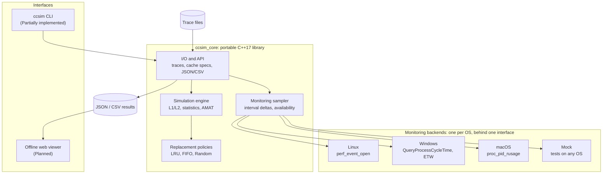

# CPU Cache Simulator (`ccsim`)

A portable C++17 tool with two modes: a deterministic **L1/L2 cache simulator** driven by memory traces, and an **interval-based hardware monitor** that reports the CPU performance counters a platform actually exposes, and says so when it does not.

> **Status: foundation, v0.1.0.** The build system, CLI shell, and smoke tests are in place. Both modes are **Planned**: `ccsim simulate` and `ccsim monitor` currently exit with code 3 (not implemented).

## Features

| Feature | Mode | Status |
|---|---|---|
| CLI shell: `--help`, `--version`, documented exit codes | Both | Implemented |
| L1 and optional L2 with configurable size, line size, associativity, hit latency | Simulation | Planned |
| Replacement policies: LRU, FIFO, seeded Random (reproducible across OSes) | Simulation | Planned |
| Text memory traces (format v1) with line-numbered errors | Simulation | Planned |
| Per-level hits, misses, evictions, write-backs; memory traffic | Simulation | Planned |
| Estimated AMAT | Simulation | Planned |
| Interval sampling of a launched command | Monitoring | Planned |
| Linux backend: `perf_event_open` | Monitoring | Planned |
| Windows backend: OS cycle accounting; elevated ETW PMU path under evaluation | Monitoring | Planned |
| macOS backend: `proc_pid_rusage` cycles and instructions | Monitoring | Planned |
| Unavailable metrics reported as `unsupported` or `permission_denied` with a reason, never as zero | Monitoring | Planned |
| JSON and CSV export; offline web viewer | Both | Planned |

## Technology stack

- C++17 (ISO, no compiler extensions) and the standard library; no runtime dependencies
- CMake 3.20 or newer, with CTest
- MSVC on Windows, GCC or Clang on Linux, Apple Clang on macOS
- Monitoring interfaces: `perf_event_open` (Linux), Win32 and ETW (Windows), `libproc` (macOS)
- Viewer (planned): static HTML and JavaScript, no build step, no CDN, works offline
- No cloud services, paid APIs, or network access at run time

## Architecture



All portable logic lives in `ccsim_core`; the CLI and viewer are thin consumers. Only the monitoring backends touch OS APIs, each compiled only on its own platform, and a mock backend makes monitoring logic testable everywhere. Details: [docs/TECHNICAL_DESIGN.md](docs/TECHNICAL_DESIGN.md).

## Quick start

Install a compiler and CMake 3.20+ first ([docs/DEVELOPMENT.md](docs/DEVELOPMENT.md#2-prerequisites)).

Linux and macOS:

```bash
cmake -S . -B build -DCMAKE_BUILD_TYPE=Release
cmake --build build
ctest --test-dir build --output-on-failure
./build/ccsim --version
```

Windows (PowerShell, Visual Studio 2022):

```powershell
cmake -S . -B build
cmake --build build --config Release
ctest --test-dir build -C Release --output-on-failure
.\build\Release\ccsim.exe --version
```

## Implementation status

Feature status is in the [Features](#features) table. Roadmap and ownership: [CONTRIBUTING.md](CONTRIBUTING.md#3-milestone-plan).

### Platform validation matrix

**Verified**: executed successfully with recorded evidence. **Partially supported**: works with documented restrictions. **Unsupported**: not available on that platform in v1, by OS limitation or design. **Not tested**: not yet executed there.

| Capability | Linux | Windows | macOS |
|---|---|---|---|
| Configure, build, smoke tests | Verified [1] | Not tested [2] | Not tested |
| Cache simulation | Not tested (Planned) | Not tested (Planned) | Not tested (Planned) |
| Monitoring: cycles, instructions | Not tested (Planned) | Not tested (Planned) [3] | Not tested (Planned) |
| Monitoring: L1D loads and misses | Not tested (Planned) | Not tested (Planned) [4] | Unsupported [5] |
| Monitoring: L2 accesses and misses | Not tested (Planned) [6] | Not tested (Planned) [4] | Unsupported [5] |
| Monitoring: last-level cache | Not tested (Planned) | Not tested (Planned) [4] | Unsupported [5] |

1. Ubuntu 24.04 x86-64: GCC 13.3 and Clang 18.1 (libstdc++ and libc++); Release and Debug; Makefiles and Ninja Multi-Config; ASan and UBSan; CMake 3.20.5 and 3.28.3; warnings as errors.
2. Cross-compiled with MinGW-w64 GCC 13 to Windows x86-64 executables (not run). MSVC not tested.
3. Without elevation, v1 reports OS-accounted `os_cycle_time`, not PMU cycles. PMU cycles and instructions need an elevated ETW session (feasibility spike in Milestone 2).
4. Possible only through ETW PMU sources: elevated, CPU-specific, custom events since Windows 10 1903.
5. Cache events are exposed only through Instruments' CPU Counters (full Xcode). v1 documents that manual workflow instead of automating it.
6. `perf_event_open` has no generic L2 event; CPU-specific raw event codes are required.

Hardware counters were not validated anywhere yet: the validation VM exposes no PMU (hardware events fail with `ENOENT`). See [TECHNICAL_DESIGN.md section 8.3](docs/TECHNICAL_DESIGN.md#83-linux).

## Documentation

| Document | Contents |
|---|---|
| [docs/TECHNICAL_DESIGN.md](docs/TECHNICAL_DESIGN.md) | Architecture, cache model, L1/L2 semantics, policies, AMAT, monitoring per OS, interfaces |
| [docs/DEVELOPMENT.md](docs/DEVELOPMENT.md) | Per-OS prerequisites, build, test, debug, troubleshooting |
| [docs/WORKING_DEMO.md](docs/WORKING_DEMO.md) | Walkthroughs, sample traces, expected results, acceptance criteria |
| [docs/FRONTEND_DESIGN.md](docs/FRONTEND_DESIGN.md) | Web UI views, visualization layout, and the frontend-to-backend API |
| [CONTRIBUTING.md](CONTRIBUTING.md) | Roles, milestones, issues, Git workflow, reviews, testing, Definition of Done |

## License

No license has been chosen yet. Until a `LICENSE` file is added, default copyright applies and the code is not open source.
