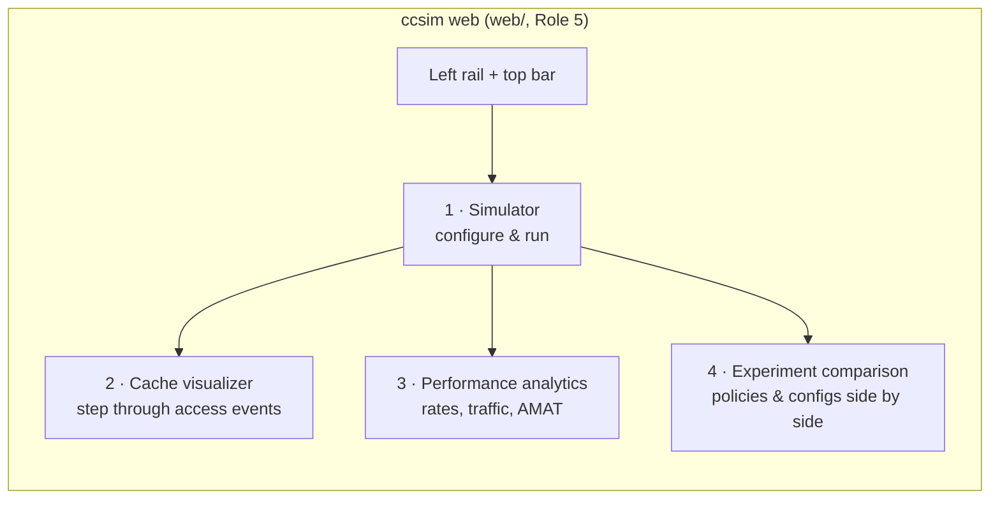
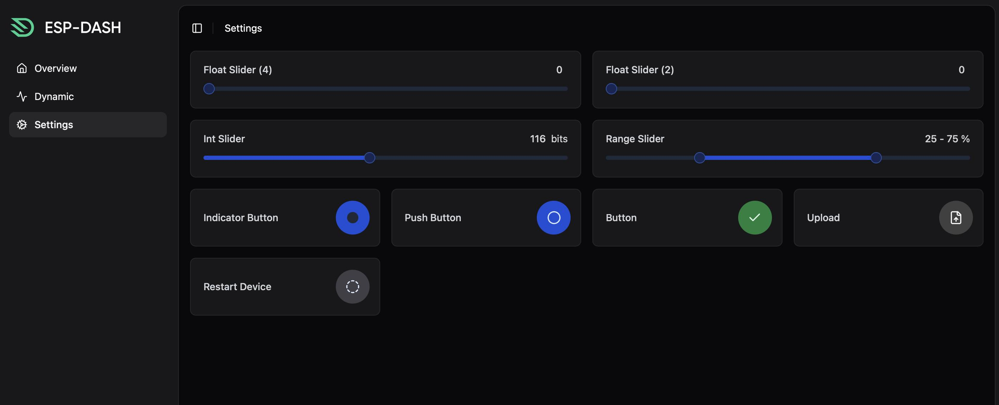
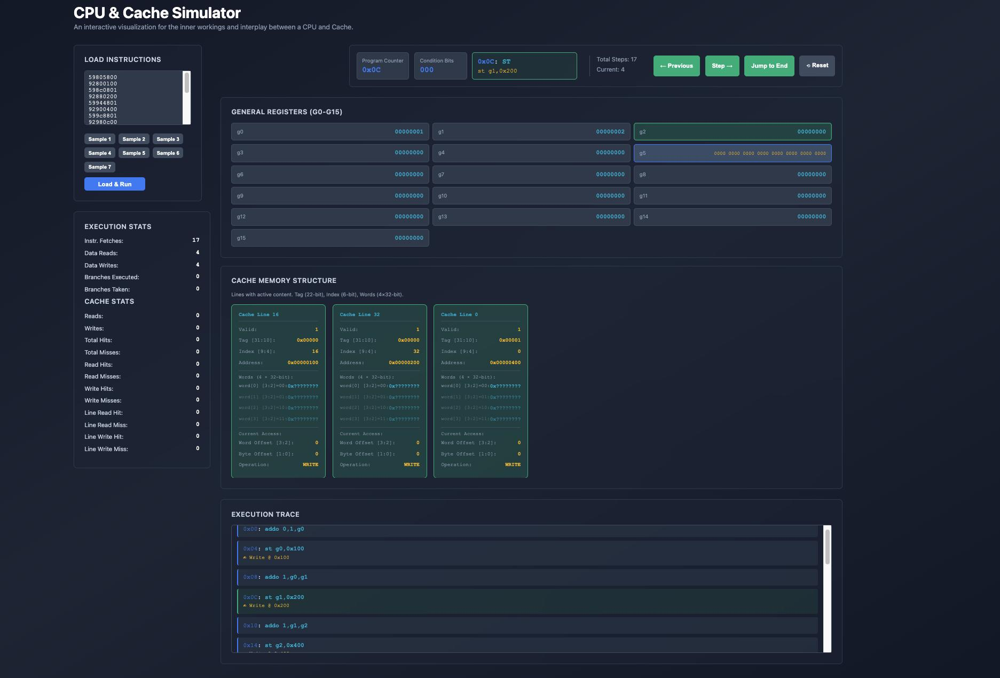
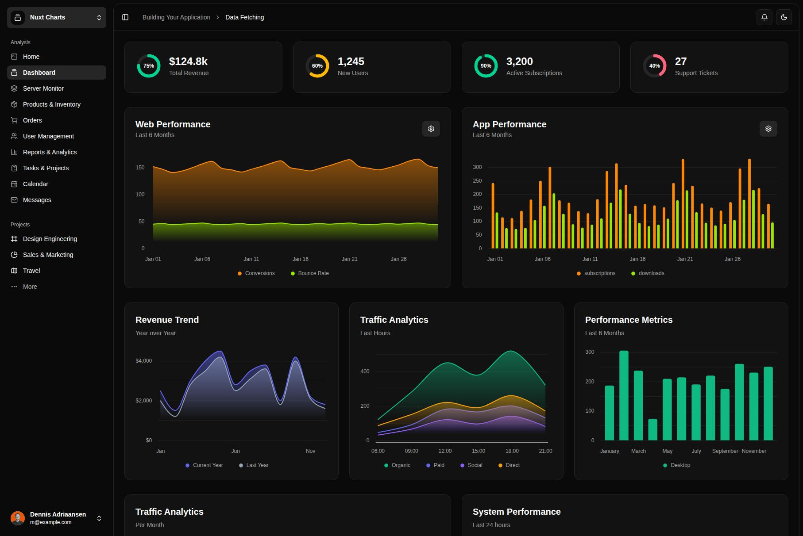
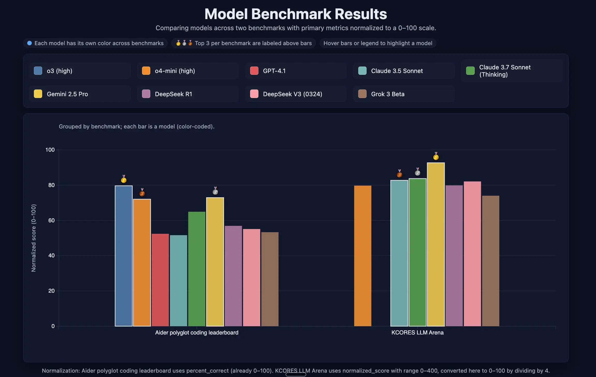
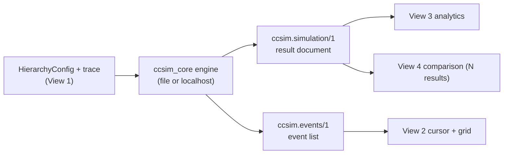

# Frontend Design

**Planned.** This document specifies the `ccsim` web frontend (Role 5, `web/`): what it looks like, how it is laid out, and — the part that is a contract — **how it talks to the backend and through which API**. Nothing here is built yet; the current repository ships only the CLI shell. The frontend is gated on the engine, the results schema, and the event stream it consumes ([TECHNICAL_DESIGN.md sections 11 and 12](TECHNICAL_DESIGN.md#11-output-schema-v1)).

The four screenshots under [`assets/images/`](../assets/images) are **visual references** for look and feel — layout density, dark theme, component style — taken from existing dashboards and one cache simulator. They are mood boards, not the target product; the content in every view is `ccsim`'s own data. Each view below names the reference it adapts.

## 1. Design principles

These follow directly from the architecture rules in [TECHNICAL_DESIGN.md section 2](TECHNICAL_DESIGN.md#2-architecture); the frontend inherits them rather than inventing its own.

1. **The frontend never simulates.** It decodes no address, decides no hit, and chooses no victim. The engine (`ccsim_core`, Role 2) is the single source of truth; the UI renders the data the engine emits and nothing more. A hit shown on screen is a hit the engine reported. This is the AC-11 equality in [WORKING_DEMO.md section 4](WORKING_DEMO.md#4-interactive-cache-debugger-demo).
2. **Offline-first.** v1 runs from static files with no network access, no CDN, and no build step required to open it (README [technology stack](../README.md#technology-stack)). A live backend connection is an optional, later transport (section 7), not a dependency of the core experience.
3. **Honest reporting.** Anything the engine marks unavailable (`null`, `n/a`, a monitoring `unsupported`/`permission_denied` reason) is shown as such, with the reason, never as `0` and never silently hidden ([TECHNICAL_DESIGN.md section 8.1](TECHNICAL_DESIGN.md#81-principles)).
4. **Deterministic in, deterministic out.** The same result file renders identically every time and on every browser; the UI adds no randomness of its own.
5. **Accessible and themeable.** Keyboard-operable controls, labelled state (never color alone), a data-table view behind every chart, and a selected dark theme — not an automatic invert.

## 2. Information architecture

A single-page app with four views reachable from a left rail, mirroring the four features. The rail and top bar style follow the **simulator.png** (ESP‑DASH) and **performance_analytics.png** (Nuxt Charts) references.



A **run** is the shared object all four views revolve around: one `HierarchyConfig` plus one trace, producing one result document and (optionally) one event stream. Views 2–4 are empty until at least one run exists; view 4 holds several runs at once.

## 3. View 1 — Simulator (configure and run)



*Reference: ESP‑DASH settings — labelled sliders, numeric fields, an upload tile, and a primary action button, in cards on a dark surface.*

**Purpose.** Let the user define the hierarchy and workload, then run the simulation. This view is the UI form over the CLI contract: every control maps to a field of `HierarchyConfig`/`CacheConfig` or a `simulate` option ([TECHNICAL_DESIGN.md sections 9–10](TECHNICAL_DESIGN.md#9-module-interfaces)).

**Layout.** Two cards, **L1** and **L2** (L2 has an enable/disable toggle, matching "optional L2"), plus a hierarchy card and a workload card.

| Control | Maps to | Rules the UI enforces client-side (the engine re-validates) |
|---|---|---|
| Capacity (`size`, with KiB/MiB) | `CacheConfig.size_bytes` | divisible by `line × ways` ([section 3](TECHNICAL_DESIGN.md#3-cache-configuration)) |
| Line size (`line`) | `CacheConfig.line_bytes` | power of two; L1 and L2 equal in v1 |
| Associativity (`ways`) | `CacheConfig.ways` | ≥ 1; `size/line` = fully associative |
| Policy | `CacheConfig.policy` | `lru` \| `fifo` \| `random` |
| Hit latency | `CacheConfig.hit_latency_cycles` | ≥ 1 |
| Memory latency | `HierarchyConfig.memory_latency_cycles` | ≥ 1 |
| Seed | `HierarchyConfig.seed` | 64-bit; only meaningful for Random |

The derived **set count** (`size / (line × ways)`) is shown live so the user sees the organisation the engine will build, and the address-split preview (tag/index/offset widths) updates with it — the same decomposition view 2 uses, computed from config, not simulated.

**Workload.** A trace is either **uploaded** (`.trace`, format v1, [section 7](TECHNICAL_DESIGN.md#7-trace-format-v1)) or **generated** from the synthetic generator's patterns — sequential, strided, random, loop (Role 8, issue M2‑13). Parse errors from a bad upload surface as `<file>:<line>: <message>`, exactly as the backend reports them, with no result rendered.

**Run.** The primary button produces a run (section 7 describes the two transports that back it) and routes the user to the cache visualizer, with analytics and comparison now populated.

**Validation defaults.** The form seeds the teaching defaults from [section 3](TECHNICAL_DESIGN.md#3-cache-configuration) (L1 32 KiB/64 B/8‑way/LRU/4, L2 256 KiB/.../12, memory 200) so a first run works with no input.

## 4. View 2 — Cache visualizer (step through access events)



*Reference: a CPU & Cache simulator — a load panel, step/previous/jump-to-end/reset controls, per-line cards showing Valid/Tag/Index/Words/Current-Access, a running stats sidebar, and an execution trace list. This is the closest reference to the real target.*

**Purpose.** This is the interactive cache debugger of [TECHNICAL_DESIGN.md section 12](TECHNICAL_DESIGN.md#12-visualization-architecture): it renders the engine's `ccsim.events/1` stream one access at a time. The four surfaces from section 12.2 map onto this layout:

- **Set/way grid** (center) — one row per set, one cell per way, for L1 and, when present, L2. Each cell shows line state (invalid / valid‑clean / valid‑dirty) and tag, with transient highlights for *just filled*, *just hit*, and *just evicted*. These are the "Cache Line" cards in the reference, generalised to a set×way grid.
- **Address inspector** (top) — splits the current access into tag, set index, and block offset using the configured widths ([section 4](TECHNICAL_DESIGN.md#4-address-mapping)) and highlights the selected set. This is the reference's `Tag [31:10] / Index [9:4] / Offset` readout.
- **Hierarchy path** (top/side) — L1 → L2 → RAM, lighting only the levels consulted for this access, with a dirty write-back drawn as a separate downward arrow ([section 5.2](TECHNICAL_DESIGN.md#52-l1l2-hierarchy)).
- **Decision panel** (side) — the per-access outcome in words: hit/miss per level, the chosen way (invalid-first or the policy's victim), eviction and write-back, and the policy's reason for the victim. Mirrors the reference's "Current Access / Operation" block and the "What to notice" narration in [Demo B](WORKING_DEMO.md#demo-b-two-level-walkthrough).

**Playback controls** (section 12.4): **Next/Step**, **Previous**, **Play**, **Pause**, **Jump to End**, **Reset**. The reference's "Step → / ← Previous / Jump to End / Reset" and "Total Steps / Current" counter are exactly this. Stepping backward is replay-from-start to the target `seq`, because cache state is not reversible.

**Execution trace** (bottom) — the scrollable access list with the current access highlighted, clickable to jump the cursor to any `seq`. This is the reference's "Execution Trace" panel.

The visualizer holds the event list and a cursor and never re-runs the engine to move within a loaded stream. Changing config or policy starts a new run (back through view 1 or the compare action), which produces a fresh stream.

## 5. View 3 — Performance analytics



*Reference: Nuxt Charts — a KPI stat-tile row over a grid of chart cards on a dark surface.*

**Purpose.** Summarise one completed run: hit/miss rates, memory traffic, eviction counts, and estimated AMAT, all read from the `ccsim.simulation/1` result ([sections 6 and 11](TECHNICAL_DESIGN.md#6-statistics-and-amat)). No value here is recomputed from the trace; the UI formats what the result already contains.

Chart choices follow the `dataviz` method (form first, then color, then validate):

- **KPI stat tiles** (top row, hero numbers — *not* charts): L1 miss rate, L2 local/global miss rate, AMAT (cycles), total memory traffic. A tile with no denominator shows `n/a`, never `0` ([section 6](TECHNICAL_DESIGN.md#6-statistics-and-amat)).
- **Per-level breakdown** — a grouped bar per level (L1, L2) of hits vs misses, read vs write. Hit and miss are a two-state distinction: encode them with a fixed categorical pair **plus a label and icon**, not red/green alone, so they survive color-vision deficiency and print. A legend is always present; the data-table view sits behind the chart.
- **AMAT contribution** — a single stacked bar decomposing total latency into L1, L2-hit, and memory components, matching the additive model in [section 6](TECHNICAL_DESIGN.md#6-statistics-and-amat). This makes "where the cycles go" legible without a second y-axis.
- **Access timeline** (optional, when an event stream is loaded) — cumulative hits/misses over `seq`, a line/area chart with a crosshair tooltip, letting a user see the working set warming up.

**One axis, always.** Miss rate (a ratio) and AMAT (cycles) are never plotted on one chart with two scales — they are separate tiles/charts. Every chart ships with a hover tooltip and a table view; the implementer runs `scripts/validate_palette.js` on the chosen palette before shipping (see the `dataviz` skill's `references/palette.md`).

## 6. View 4 — Experiment comparison



*Reference: "Model Benchmark Results" — grouped, color-coded bars with a per-entity legend, top-N callouts, hover-to-highlight, and a normalization note. The structure maps directly onto comparing cache experiments.*

**Purpose.** Run the **same trace** under varied configuration — LRU vs FIFO vs Random, or swept cache size / associativity / workload — and compare the outcomes, then export. Each experiment is a run; the view holds a set of runs and lines them up.

**Layout and encoding** (per `dataviz`):

- **Grouped bars**, grouped by metric (miss rate, AMAT, evictions, memory traffic) with one bar per experiment, or grouped by experiment with one bar per metric — the user toggles the grouping. **Color follows the experiment** (the entity), assigned in fixed categorical order and never cycled; changing which experiments are shown must not repaint the survivors.
- A **legend is always present**; the top result per metric is direct-labeled (the reference's medal callouts), the rest on hover.
- Because metrics have different units, **each metric is its own chart or panel** (ratios with ratios, cycles with cycles) — never one axis spanning miss rate and AMAT. A normalization note, like the reference's footer, states any 0–100 scaling if a combined view is offered.
- **Export**: the comparison table as CSV and the current chart as a self-contained SVG/PNG, plus a copyable list of the exact `ccsim` invocations that produced each run, so a result is reproducible from the doc.

A comparison needs no new engine capability: it is several `simulate` runs over one trace, each yielding a `ccsim.simulation/1` document, aggregated in the browser.

## 7. Frontend ↔ backend contract (the API)

The "backend" is `ccsim_core` behind the `ccsim` CLI (Roles 2, 3, 6). There are **two transports**, and the frontend is written against the *schemas*, so the same view code works over either.

### 7.1 Transport A — file-based (v1, offline, no new contract)

This is the v1 path and it reuses contracts that already exist; it adds **no** network API.

1. The user runs the backend (or the app shells out to it over transport B) to produce files:

   ```bash
   # aggregate result for views 1, 3, 4
   ccsim simulate --trace demo_b.trace --format json --output run.json \
     --l1 size=64,line=16,ways=2,policy=lru,latency=1 \
     --l2 size=128,line=16,ways=2,policy=lru,latency=10 --memory-latency 100
   # per-access event stream for view 2 (planned flag, section 12.3)
   ccsim simulate --trace demo_b.trace --emit-events run.events.ndjson [...same config...]
   ```

2. The frontend loads those files through a file picker (no fetch, no server) and renders them.

**Payloads** are the frozen schemas — the frontend parses, it does not define them:

| View needs | Schema | Produced by | Spec |
|---|---|---|---|
| Rates, traffic, AMAT, per-level counters | `ccsim.simulation/1` (JSON) | `ccsim simulate --format json` | [section 11](TECHNICAL_DESIGN.md#11-output-schema-v1) |
| Per-access decode, hit/miss, victim, fill, write-back, latency | `ccsim.events/1` (NDJSON, one event/line) | `ccsim simulate --emit-events` | [section 12.3](TECHNICAL_DESIGN.md#123-engine-event-stream) |
| Monitoring time series (if a monitoring view is added later) | `ccsim.monitor/1` | `ccsim monitor` | [section 11](TECHNICAL_DESIGN.md#11-output-schema-v1) |

This satisfies **AC‑9** (JSON carries `"schema"` v1 and loads in the viewer with no network). It is the mode the README viewer promises: static, offline, file-picker driven.

### 7.2 Transport B — localhost API (optional, post-v1, open decision)

The fully live experience in the images — configure, click Run, watch it step without touching a file — needs the app to invoke the backend directly. That means a thin **localhost HTTP + WebSocket server**, `ccsim serve`, which is an explicit **open decision (post-v1, not in v1)** in [TECHNICAL_DESIGN.md section 14](TECHNICAL_DESIGN.md#14-open-decisions) and requires Role 1 approval and a contract added through the [section 2 protocol](../CONTRIBUTING.md#2-shared-interfaces-and-ownership-boundaries). It is documented here so the frontend is designed to drop onto it without rework — same schemas, different transport.

Proposed surface (loopback only, same-origin, no auth, no external access — consistent with "no cloud, no network at run time"):

| Method & path | Request | Response | Backs |
|---|---|---|---|
| `GET /api/defaults` | — | default `HierarchyConfig` + field limits | View 1 form seeding |
| `POST /api/simulate` | `{ config: HierarchyConfig, trace: {inline\|ref} }` | `ccsim.simulation/1` | Views 1, 3 |
| `POST /api/events` | same as simulate | `ccsim.events/1` as NDJSON (stream) | View 2 load |
| `GET  /ws/run?id=` | — (WebSocket) | events pushed per `seq` for live Play/Step | View 2 playback |
| `POST /api/compare` | `{ trace, configs: HierarchyConfig[] }` | `ccsim.simulation/1[]` | View 4 |
| `POST /api/trace/generate` | generator params (pattern, length, seed) | `.trace` text | View 1 workload |

Contract rules: request `config` is exactly the validated `HierarchyConfig`; a `ConfigError`/`TraceError` returns HTTP 400 with the engine's `<source>:<line>: <message>` text (never a 500 for user input), mirroring CLI exit code 1 ([section 10](TECHNICAL_DESIGN.md#10-cli-contract)). Responses are byte-identical to the file outputs of transport A, so **nothing in views 1–4 changes** between the two transports — only the data source does. The WebSocket exists purely to stream an already-computed, deterministic event list in real time; it is not a second, live simulator.

### 7.3 Why file-based is the v1 answer

Transport A ships the whole frontend with zero new backend contract, zero network surface, and full offline/CI testability (the viewer loads sample files in CI, AC‑9). Transport B is the ergonomics upgrade and is deliberately deferred until Role 1 decides `ccsim serve` is in scope. Designing to the schemas rather than to HTTP is what lets us start on A and adopt B later without reworking the views.

## 8. Application state and data flow



- A **run** = `{ config, traceRef, result, events? }`. The store keeps the active run for views 2–3 and a set of runs for view 4.
- View 2 state is just the event list plus an integer **cursor**; all playback is cursor movement, and the grid is a pure function of events `[0..cursor]`. Reset sets the cursor to −1 (empty grid) and replays from 0.
- No derived cache fact is stored that the engine did not emit; if a number isn't in the schema, the UI doesn't show it (or shows `n/a`).

## 9. Technology and constraints

- **Static, no build step required, no CDN, works offline** (README technology stack). All assets — scripts, styles, fonts, icons — are vendored under `web/`; nothing is fetched at run time.
- **Charts** are inline SVG/HTML built per the `dataviz` skill (form → color → validate → marks → hover → a11y). No charting CDN. Run `scripts/validate_palette.js` on the palette before shipping; keep a table view behind every chart.
- **Browsers**: current Chrome, Firefox, Edge, Safari, opened from a file picker with no network requests (Role 5 acceptance, [CONTRIBUTING.md Role 5](../CONTRIBUTING.md#role-5-frontend--visualization)).
- **If a framework is later adopted** for the localhost experience, it must still emit a self-contained offline bundle with no CDN and no network calls; that is a joint Role 5 / Role 10 decision, not a default.
- **Accessibility**: keyboard-operable playback, focus-visible controls, state conveyed by text/icon as well as color, and `prefers-reduced-motion` honored for the transient cell highlights.

## 10. Acceptance criteria and ownership

Owner: **Role 5** ([CONTRIBUTING.md](../CONTRIBUTING.md#role-5-frontend--visualization)). Depends on the schema v1 and sample files (Role 6, M1) and the event stream (Role 2, section 12). The frontend-specific criteria:

1. **FE‑1** Every view renders from backend-produced files alone, offline, with no network request (extends **AC‑9**).
2. **FE‑2** The cache visualizer's on-screen state equals the engine events at every step, and its final grid/counters equal the `ccsim.simulation/1` result for the golden traces — the UI runs no cache logic of its own (this is **AC‑11**, [WORKING_DEMO.md section 6](WORKING_DEMO.md#6-acceptance-criteria)).
3. **FE‑3** Unavailable values render as `n/a`/`null` with the reason, never as `0`.
4. **FE‑4** Every chart has a legend (≥ 2 series), a hover tooltip, and a data-table view; the palette passes the `dataviz` validator in light and dark modes.
5. **FE‑5** Comparison export reproduces each run's exact `ccsim` invocation alongside the numbers.

**Open decisions** (tracked in [TECHNICAL_DESIGN.md section 14](TECHNICAL_DESIGN.md#14-open-decisions)): whether the `ccsim.events/1` schema and the interactive debugger land in v1, and whether the localhost `ccsim serve` API (transport B) is in scope. Until those are decided, the file-based transport (A) is the committed path.

## 11. References

- Visualization architecture and event stream: [TECHNICAL_DESIGN.md section 12](TECHNICAL_DESIGN.md#12-visualization-architecture)
- Results schema v1, CLI contract, address mapping, statistics/AMAT: [TECHNICAL_DESIGN.md sections 4, 6, 10, 11](TECHNICAL_DESIGN.md#4-address-mapping)
- Debugger walkthrough and acceptance: [WORKING_DEMO.md section 4](WORKING_DEMO.md#4-interactive-cache-debugger-demo) and [AC‑11](WORKING_DEMO.md#6-acceptance-criteria)
- Role 5 scope and acceptance: [CONTRIBUTING.md](../CONTRIBUTING.md#role-5-frontend--visualization)
- Chart method: the `dataviz` skill (`references/choosing-a-form.md`, `color-formula.md`, `palette.md`, `scripts/validate_palette.js`)
