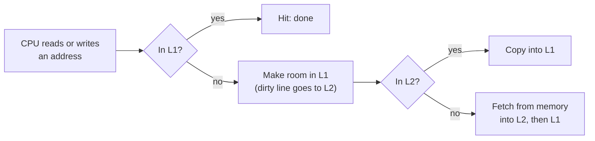
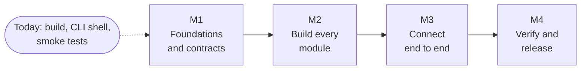

# ccsim at a glance

A tool that shows how CPU caches work: **simulate** them from a trace, or **monitor** a real CPU while a program runs.

## Why caches matter

Memory is huge but slow. Caches are small and fast. Every miss pushes the request one level further down.

## What happens on every access

Every step is counted: hits, misses, evictions, write-backs.

## How the cache finds a line

## Who gets evicted when a set is full

| Policy | Evicts |
|---|---|
| LRU | The line unused for the longest time |
| FIFO | The line that arrived first |
| Random | Any line, from a seeded generator, so runs are repeatable |

## What each OS lets us measure

| | Linux | Windows | macOS |
|---|---|---|---|
| Cycles, instructions | Yes | OS cycle time; more with Administrator | Yes, if the OS reports them |
| L1 data cache | Yes, if the CPU exposes it | Needs Administrator | Instruments only |
| L2 cache | CPU-specific codes | Needs Administrator | Instruments only |

Anything unavailable shows as `n/a` with the reason. This table is the v1 plan; none of it is tested on hardware yet.

## Where we are

Working now: the build on Linux, `ccsim --help` and `ccsim --version`. Everything else is planned.

## Go deeper

| Read | For |
|---|---|
| [TECHNICAL_DESIGN.md](TECHNICAL_DESIGN.md) | Exact rules, interfaces, OS details |
| [WORKING_DEMO.md](WORKING_DEMO.md) | Step-by-step examples with expected results |
| [DEVELOPMENT.md](DEVELOPMENT.md) | Build and test on your OS |
| [../CONTRIBUTING.md](../CONTRIBUTING.md) | Team roles and workflow |